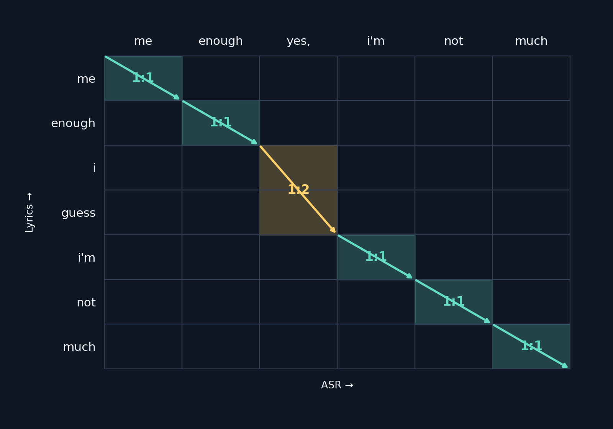
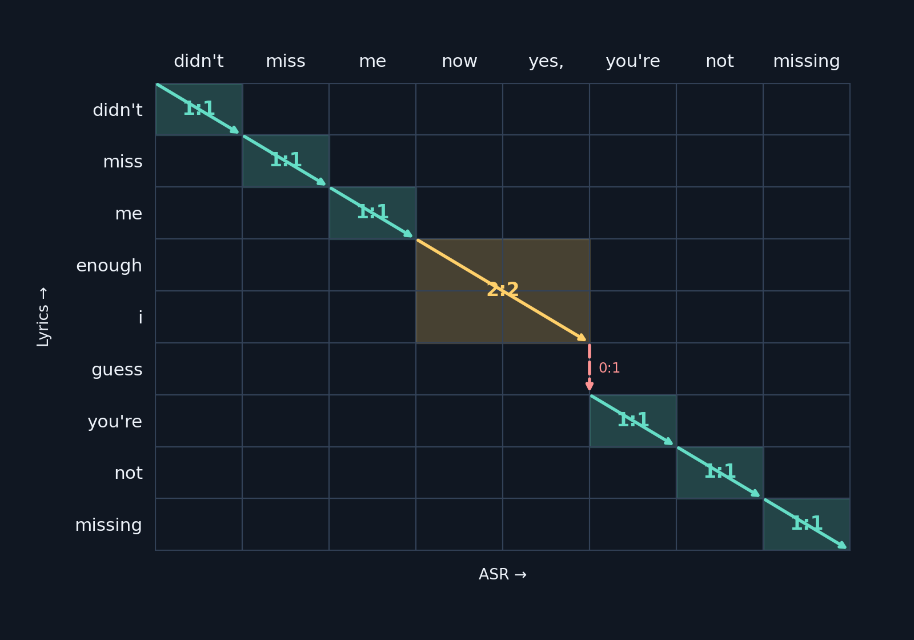
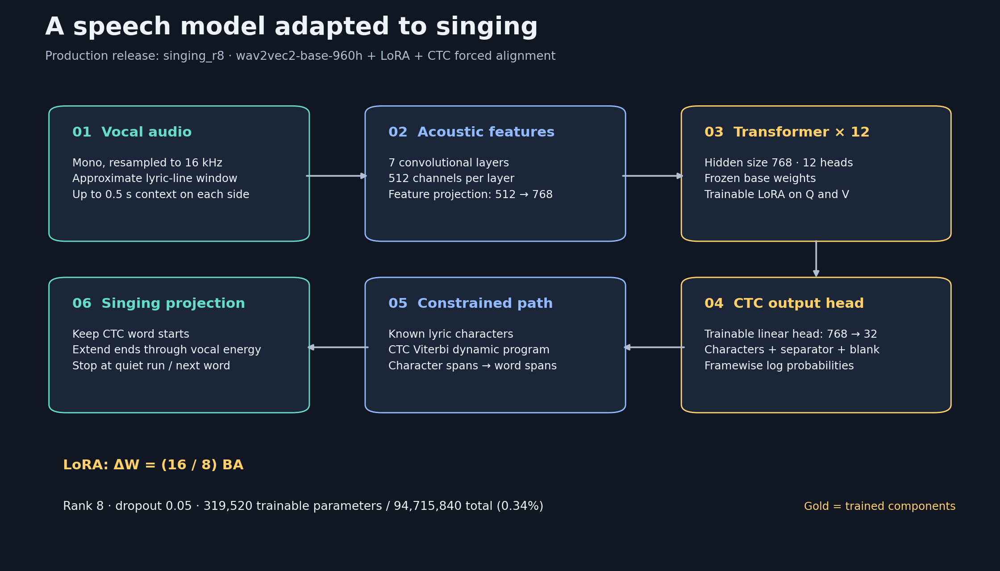
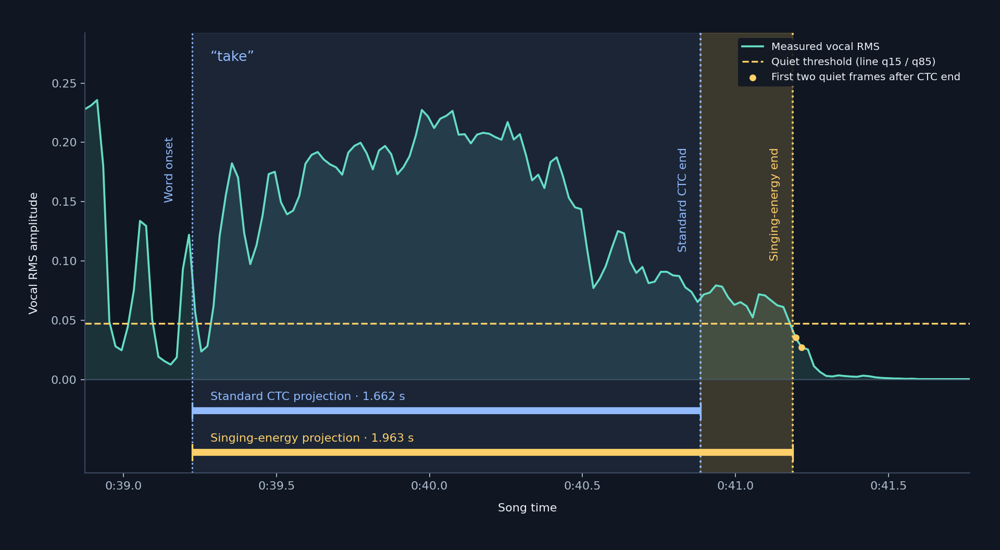
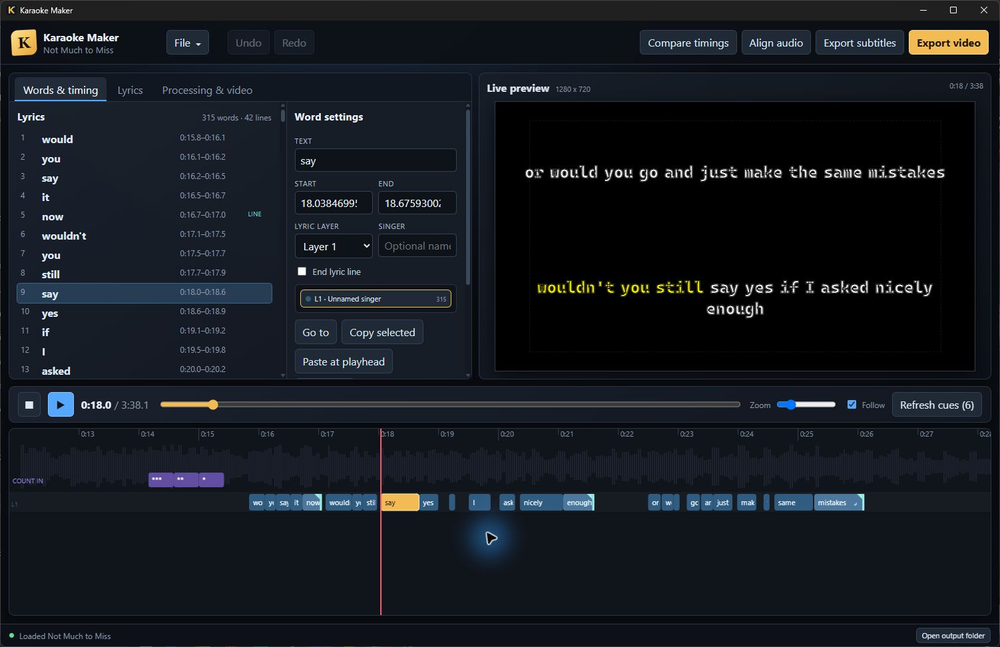

I like karaoke, but the songs I want to sing never have karaoke versions on YouTube.  This project is a fully automated way to get a karaoke video as long as you have the song and lyrics.  Raw speech recognition isn't accurate, but its timings are as long as we match them to the real lyrics.  I also trained a forced alignment model to get the timings as accurate as possible, but if things are still a bit off, there's a UI to fine tune the timings.

[Source code](https://github.com/DubiousLatchkey/karaoke-maker)

## The Pipeline

The processing pipeline has five main stages:

1. **Separate the audio.** HTDemucs produces vocal and instrumental stems.
2. **Find approximate words and times.** Whisper-based transcription provides a coarse alignment, using either EasyTranscriber or WhisperX.
3. **Match the supplied lyrics.** A global many-to-many matcher reconciles the inaccurate transcript lyrics with the real lyric text.
4. **Refine the word boundaries.** My custom singing-adapted wav2vec2 model aligns the known text inside approximate lyric-line windows, then an energy-based projection handles sustained endings.
5. **Review and render.** The editor saves corrected timings; ASS subtitles and FFmpeg render the karaoke video over the instrumental track. Beat This! supplies beat-based count-ins, and the app can also export YouTube Timed Text.

Audio separation and ASR results are cached. Changing lyrics or matcher settings can reuse the expensive audio work, while changes to the source audio or transcription configuration invalidate the relevant cache.

## Many-to-many Matching: Turn Bad ASR Output Words into Properly Timed Real Lyrics

_1:05–1:10 in “Not Much to Miss”: the matcher maps ASR “yes” to the supplied words “I guess” as a 1:2 block, with exact 1:1 matches on either side._

_3:08–3:13: the saved path contains a 2:2 block mapping “now yes” to “enough I,” followed by an unmatched “guess.” This low-confidence result shows where acoustic refinement and manual review are still needed._

ASR is aggresively mediocre at catching words in songs.  Often, a singer will sing something and the speech recognition will divide it into two words.  Or, some will just get dropped entirely if the borders aren't clear which is pretty common in singing.  Here are some examples of how the many to many matching scores incorrect words via Levenshtein distance to try and account for these situations.  I tried some phoneme based methods, but they were much more computationally expensive and didn't really improve things.

An important restriction is **irreducibility**: a larger block containing an exact token pair is rejected. The outer dynamic program must emit that exact pair separately, so an easy match cannot hide unrelated neighboring words inside an oversized block. After backtracking, the chosen operations project coarse ASR times onto the lyric words; the acoustic refiner then works on the resulting line windows.

## Training a CTC Aligner for Singing

_The production `singing_r8` release. Gold identifies trained components; the pretrained backbone is frozen._

[View the full-size architecture diagram](/assets/images/karaoke-maker/ctc-architecture.png).

I adapted **facebook/wav2vec2-base-960h** rather than training an acoustic model from scratch. Its seven-layer convolutional feature encoder feeds a 768-dimensional, twelve-layer transformer. Rank-8 LoRA adapters modify the attention query and value projections, and the CTC output head maps the hidden states to a 32-token vocabulary.

The model produces frame-level character probabilities. Given the correct lyric text, a CTC Viterbi path aligns those characters to the audio, then groups them into words. This is **forced alignment**, not a replacement for full-song transcription: it needs the text and an approximate window for each lyric line. Context padding is capped at neighboring line boundaries to reduce leakage from adjacent vocals.

I trained on **724 English JamendoLyrics line clips**, with **144 validation clips held out by song**. Only **319,520 of 94,715,840 parameters—about 0.34%—were trainable**. Validation CTC loss fell from **3.0599 to 2.5965** across three epochs.  Could probably go further on this with more data or even using the videos I make as another dataset.

On a separate frozen set of five manually timed local projects, the rank-8 model with the singing projection achieved **78.73 ms mean absolute boundary error** across 1,994 alignable words. That test supplied the correct lyric lines and manually derived line windows; it measures line-conditioned alignment, not end-to-end automatic transcription accuracy. Larger boundary-supervised adapters were also tested, but the small rank-8 release remains the production default.

## Word Projection Changes: Singing Energy

_Line-final “take” at 0:39.224 in “Not Much to Miss,” measured from the separated vocal stem using the same rank-8 model output for both projections. Standard CTC ends at 0:40.886 (1.662 seconds); the singing projection follows the remaining vocal energy to 0:41.187 (1.963 seconds), an extension of about 300 ms. The longer endpoint agrees with the saved editor timing._

[View the full-size singing-energy breakdown](/assets/images/karaoke-maker/singing-energy.png).

CTC character emissions can finish before a sustained vowel does. If I use the last emitted character as the end of the word, the karaoke highlight can disappear while the singer is still holding the note. The singing projection keeps the CTC starts and extends the ends using the separated vocal signal:

1. **Measure frame energy.** Compute RMS amplitude in a short window centered on each acoustic frame, using the median frame spacing to size the window.
2. **Choose a line-relative quiet threshold.** Take the 15th and 85th energy percentiles and set `threshold = q15 + 0.20 × max(0, q85 − q15)`. This adapts the rule to the current line's energy range.
3. **Search after the lexical end.** Look for the first run of two consecutive frames at or below that threshold, stopping the search before the next aligned word begins.
4. **Assign the ending.** Stop immediately before the quiet run, without shortening the original span. If no quiet run exists, extend to the frame before the next word. For a final word with no quiet run, retain its original end.

The rule is deliberately constrained: it cannot cross the next word's onset. It also depends on the vocal stem—reverb, background vocals, and separation artifacts can keep energy high even after the intended word ends. The editor remains available for those cases, and the application preserves coarse timings as a fallback if refinement fails.

## The UI

_The desktop application with “Not Much to Miss” loaded. The preview, selected word, waveform, and timing blocks all refer to the same playhead._

[View the full-size editor screenshot](/assets/images/karaoke-maker/editor.png).

I built this GUI with React, TypeScript, and Tauri, while keeping the audio and machine-learning pipeline in Python. Playback uses a persistent Web Audio context and a decoded audio buffer so checking a tiny timing adjustment does not incur a fresh audio-startup delay.

The editor has a live 16:9 preview (though it's pretty limited), draggable word boundaries, group selection, undo/redo, and lyric editing. Overlapping singers can be assigned separate lyric layers manually since this can't be done automatically (yet!). The automated pipeline stays single-layer; the editor is where I handle those more complicated cases.

## Example video

  <iframe src="https://www.youtube.com/embed/pylM6GwLu0s" title="[Karaoke] Not Much to Miss — Matthew Chen" loading="lazy" style="position: absolute; inset: 0; width: 100%; height: 100%; border: 0;" allow="accelerometer; autoplay; clipboard-write; encrypted-media; gyroscope; picture-in-picture; web-share" referrerpolicy="strict-origin-when-cross-origin" allowfullscreen></iframe>

